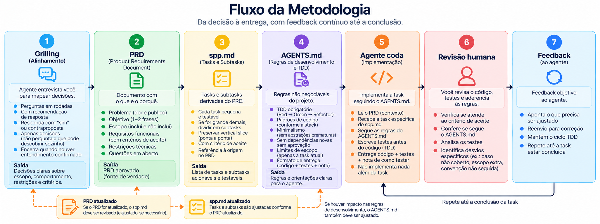
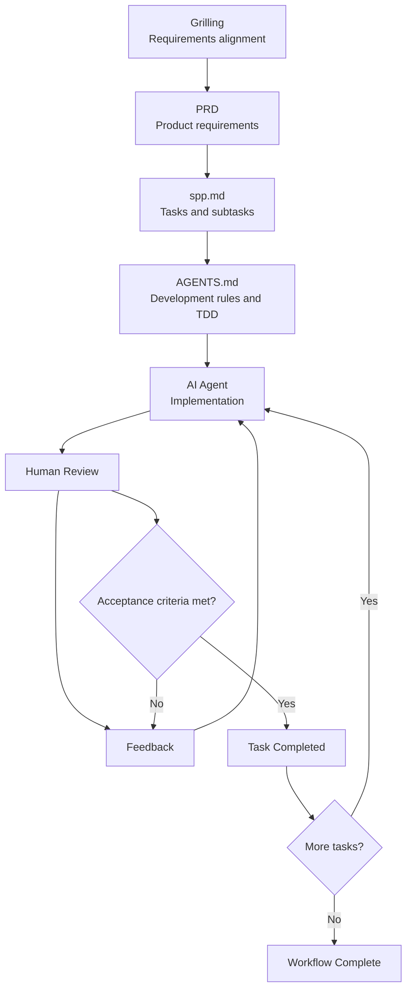

# Agent Workflow

**A structured workflow for AI-assisted software development.**

Agent Workflow is a methodology for building software with AI coding agents through explicit requirements, small testable tasks, mandatory Test-Driven Development (TDD), and human review.

The goal is to reduce assumptions, keep implementation within the agreed scope, and make every change easier to verify.

## Workflow Overview



## The Workflow



## Core Principles

- **Decisions before implementation:** clarify requirements before planning development work.
- **Explicit requirements:** use the PRD as the source of truth for scope and expected behavior.
- **Small, testable tasks:** break work into independently verifiable tasks and subtasks.
- **Mandatory TDD:** write a failing test before implementing production code.
- **Controlled scope:** the agent works only on the currently assigned task.
- **Human oversight:** a human reviews the implementation, tests, and compliance with project rules.
- **Iterative feedback:** corrections are based on specific, actionable feedback.

## Workflow Stages

### 1. Grilling — Requirements Alignment

Before writing the PRD, the agent conducts a structured interview to clarify product decisions and establish a shared understanding with the user.

This stage is inspired by Matt Pocock's **Grilling** skill:

**Reference:** [mattpocock/skills — Grilling SKILL.md](https://github.com/mattpocock/skills/blob/main/skills/productivity/grilling/SKILL.md)

The skill provides the foundation for a decision-driven interview: explore the design space, identify unresolved decisions, recommend answers, investigate facts independently, and wait for the user's confirmation before proceeding.

Within this workflow, the grilling process follows these principles:

- Explore the relevant branches of the decision tree.
- Identify which decisions can be made without depending on unresolved answers.
- Ask questions in structured rounds, with a recommended answer for each question.
- Investigate facts using the repository, existing documentation, and available tools instead of asking the user to find them.
- Leave product decisions to the user.
- Do not proceed to implementation until the user explicitly confirms that a shared understanding has been reached.

The session is complete when all relevant decisions have been resolved and the user confirms alignment.

**Output:** agreed decisions about scope, expected behavior, constraints, and acceptance criteria.

### 2. PRD — Product Requirements Document

The PRD translates the decisions from grilling into a concise product specification.

It should focus on **what** needs to be built and **why**, rather than prescribing every implementation detail.

A PRD should cover:

- Problem and target audience
- Objectives
- In-scope and out-of-scope items
- Functional requirements and acceptance criteria
- Technical constraints
- Open questions, if any

The PRD is the source of truth for the subsequent planning and implementation stages.

The agent must not silently expand the scope beyond the agreed requirements.

### 3. `spp.md` — Tasks and Subtasks

The `spp.md` file translates the PRD into actionable development tasks.

Each task should be small enough to implement and test independently. If a task is too large, divide it into subtasks.

Whenever possible, subtasks should preserve the **vertical slice** principle: each subtask should deliver a testable piece of functionality rather than an isolated technical layer.

Each task should include:

- A short title
- Its source requirement in the PRD
- A verifiable acceptance criterion
- Subtasks, when necessary

Example structure:

```markdown
## Task: [Short title]

**PRD reference:** [Requirement or section]

**Acceptance criteria:** [What must be true for completion]

**Subtasks:**
- [ ] Subtask 1
- [ ] Subtask 2
```

### 4. `AGENTS.md` — Development Rules and TDD

The `AGENTS.md` file defines the project's non-negotiable development rules.

These rules should be adapted to the project's technology stack and context.

They should cover:

- Mandatory Test-Driven Development
- Code style, naming, typing, and quality conventions
- Minimal solutions without premature abstractions
- Dependency restrictions
- Task scope boundaries
- Test execution commands
- Delivery expectations

#### The TDD Cycle

The agent must follow this sequence:

1. **Red:** write a test that fails for the expected reason.
2. **Green:** implement the minimum production code required to pass the test.
3. **Refactor:** improve the implementation while keeping the tests passing.

No production code should be written without a test that fails first.

The `AGENTS.md` file must provide a clear command for running the relevant tests.

### 5. AI Agent — Implementation

For each implementation cycle, provide the agent with:

- The PRD for context
- The specific task or subtask to implement
- The `AGENTS.md` development rules

Assign one task at a time, rather than providing the entire task backlog as an unrestricted implementation request.

The agent must:

- Follow the current task's acceptance criteria
- Apply the project's TDD rules
- Respect existing conventions
- Avoid unnecessary abstractions and dependencies
- Stop and report when a requirement or dependency is missing or an unplanned change becomes necessary

**Expected output:** implementation, tests, and a brief note explaining what changed and how to test it.

### 6. Human Review

After implementation, a human reviews the changes before accepting the task.

The review should verify:

- Compliance with the acceptance criteria
- Test coverage and test results
- Adherence to `AGENTS.md`
- Scope control
- Unnecessary complexity or dependencies

If the implementation does not meet the requirements, the reviewer provides specific, actionable feedback.

### 7. Feedback Loop

The agent uses the review feedback to correct the implementation while continuing to follow TDD.

The review and correction cycle repeats until the acceptance criteria are satisfied.

Once the task is accepted, it is marked as completed in `spp.md`, and work proceeds to the next task.

## What Happens When the PRD Changes?

The PRD remains the source of truth. When it changes, the affected artifacts must be reviewed before implementation continues.

1. Update or clarify the PRD.
2. Identify affected tasks and subtasks in `spp.md`.
3. Update `AGENTS.md` only if development rules or technical constraints are affected.
4. Reassess the current implementation and tests against the updated requirements.
5. Reopen previously completed tasks if they no longer satisfy the revised requirements.
6. Resume development with the revised tasks and acceptance criteria.

Not every change requires rebuilding everything. Update only what is affected, while checking dependencies and consistency across the workflow.

## Artifact Responsibilities

| Artifact | Purpose | Primary responsibility |
|---|---|---|
| Grilling | Clarify decisions and assumptions | Agent interviews; user decides |
| `PRD.md` | Define requirements and scope | Agent and user |
| `spp.md` | Organize actionable tasks | Agent and user |
| `AGENTS.md` | Define development rules and TDD | User, with agent assistance |
| Code and tests | Implement the current task | AI agent |
| Review and feedback | Verify and correct implementation | Human reviewer |

## References

- **Grilling skill by Matt Pocock:** [skills/productivity/grilling/SKILL.md](https://github.com/mattpocock/skills/blob/main/skills/productivity/grilling/SKILL.md)

## Guiding Principle

**The human owns the decisions. The agent owns the implementation within the agreed boundaries.**

Grilling clarifies intent. The PRD defines requirements. `spp.md` organizes the work. `AGENTS.md` governs implementation. TDD makes changes verifiable. Human review and feedback close the loop.

The result is a disciplined, iterative workflow in which implementation remains traceable to explicit requirements.

---

*This methodology is intended to be adapted to each project's stack, constraints, and development environment.*